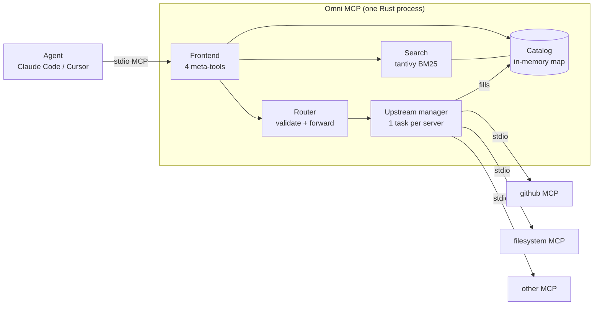
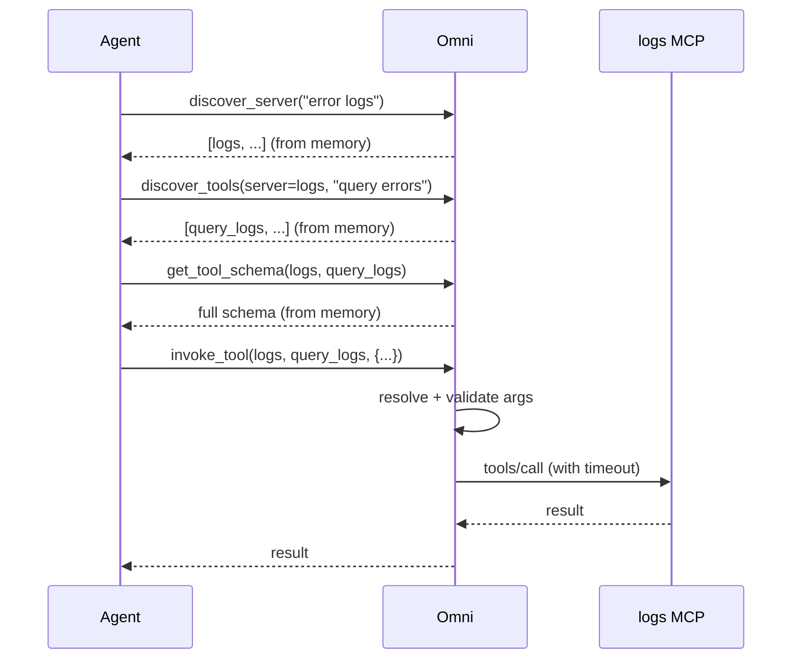

# Omni MCP — MVP Design (v0.1 "Does it work?")

Status: design only, no code yet · Source: `Omni MCP — System Design` (full design, 14 pages)

## 1. Purpose of the MVP

The full design is large (8 components, 7 crates, 7 releases). Before building it, we need
to answer **one question** cheaply:

> If an agent sees only 4 meta-tools instead of every upstream tool, can it still find and
> call the right tool, and does it use far fewer tokens doing so?

The MVP exists to prove or disprove that. Everything that does not help answer it is cut.

### Success criteria (the "go / no-go" test)

| # | Criterion | Target |
|---|-----------|--------|
| 1 | Agent finishes real tasks through Omni against 2–3 real MCP servers | works end to end in Claude Code |
| 2 | Tool-definition tokens seen by the agent | < 2,000, constant as tools grow |
| 3 | Search Recall@5 on ~50 hand-labelled queries over ~200–500 tools | ≥ 85% |
| 4 | Token saving vs. loading all tools directly | ≥ 80% fewer tool-definition tokens |
| 5 | A crashing upstream does not break the agent or other upstreams | verified manually |

If 1–4 hold, the idea is viable → continue the full roadmap. If recall is poor, fix search
(embeddings, descriptions) *before* building anything else.

## 2. Scope

### In the MVP

- Rust single binary, **stdio frontend** (works with Claude Code / Cursor).
- The **four meta-tools**: `discover_server`, `discover_tools`, `get_tool_schema`, `invoke_tool`.
- **Upstream manager**: connect to upstream MCP servers over **stdio** from a TOML file;
  one task per server (isolation); simple restart on crash.
- **In-memory catalog**: on connect, `tools/list` (with pagination) → HashMap keyed by `(server, tool)`.
- **Search: BM25 only** (`tantivy`), fields: tool name (words split), description, param names, server name/tags.
- **Router (minimal)**: resolve → validate args against JSON schema → forward with timeout → return result.
- Errors returned as `isError: true` tool results with a hint, never protocol errors.
- **Mini benchmark script**: labelled queries → Recall@1/5/MRR + token count comparison.

### Explicitly NOT in the MVP (deferred)

| Deferred | Back in |
|----------|---------|
| Embeddings, RRF fusion, re-ranker | v0.3 |
| SQLite persistence, schema versions, usage stats | v0.2 |
| Health checker, circuit breaker, hot reload | v0.4 |
| Policy / approvals / redaction / HTTP auth | v0.6 |
| Streamable HTTP transport, multi-session | v0.6 |
| Field projection, metrics, OpenTelemetry, Docker | v1.0 |
| Per-user token passthrough | later |

Rationale: none of these affect "can the agent find and call the right tool". They are
hardening, not validation.

## 3. Architecture (MVP)



Only the frontend is visible to the agent. Each upstream lives in its own tokio task, so a
slow or dead server cannot block the others.

### Components

| Component | MVP responsibility |
|-----------|--------------------|
| Frontend | `rmcp` stdio server; `tools/list` always returns exactly 4 tools |
| Upstream manager | Spawn child process, run `initialize`, `tools/list`, forward `tools/call`; restart with backoff on exit |
| Catalog | `HashMap<(server, tool), ToolEntry>` + server metadata; rebuilt at startup |
| Search | tantivy index built from the catalog at startup; rebuilt when a server (re)connects |
| Router | Look up tool, validate args with `jsonschema`, call upstream with deadline, return result |

## 4. Meta-tool contract

| Tool | Input | Output |
|------|-------|--------|
| `discover_server` | `query`, `limit=5` | `[{server, description, tool_count}]` |
| `discover_tools` | `server?`, `query`, `limit=10` | `[{server, tool, one_line_description, score}]` |
| `get_tool_schema` | `server`, `tool` | full `inputSchema` + description + annotations |
| `invoke_tool` | `server`, `tool`, `arguments` | upstream `CallToolResult`, unchanged |

Rules:

- Tool identity is always the pair `(server, tool)` → no name clashes.
- Tool descriptions are short and teach the order: **discover → schema → invoke**.
- `discover_tools` without `server` searches across everything (shortcut for strong models).
- Errors carry a hint, e.g. `unknown tool 'x' on 'github'. Closest: list_issues, get_issue`.

## 5. Request flow

Example: *"find error logs for the payments service in the last hour"*



Three of four calls are answered from Omni's own memory in milliseconds; only `invoke_tool`
touches an upstream.

## 6. Config (MVP)

`omni.toml`:

```toml
[[server]]
name        = "filesystem"
transport   = "stdio"
command     = "npx"
args        = ["-y", "@modelcontextprotocol/server-filesystem", "/tmp/demo"]
description = "Read and write local files"
tags        = ["files"]
timeout_ms  = 15000

[[server]]
name        = "github"
transport   = "stdio"
command     = "npx"
args        = ["-y", "@modelcontextprotocol/server-github"]
env         = { GITHUB_TOKEN = "${GITHUB_TOKEN}" }
description = "Repos, issues, pull requests"
tags        = ["code", "git"]
```

Tokens come from environment variables only; never logged.

## 7. Proposed layout (single crate to start)

```
omni-mcp/
├── Cargo.toml
├── omni.toml
├── src/
│   ├── main.rs        # load config, start everything
│   ├── config.rs      # omni.toml parsing
│   ├── upstream.rs    # connection tasks (spawn, initialize, call, restart)
│   ├── catalog.rs     # in-memory tool map
│   ├── search.rs      # tantivy BM25 index + query
│   ├── router.rs      # resolve, validate, forward
│   └── frontend.rs    # rmcp server, 4 meta-tools
└── bench/
    ├── queries.json   # labelled (query → server, tool)
    └── run.py|rs      # Recall@k, MRR, token comparison
```

Split into the workspace crates from the full design (`omni-core`, `omni-search`, …) only
once the MVP passes. Splitting early is overhead.

## 8. Validation plan

1. **Smoke test** — connect Omni to 2 real servers (filesystem + one more); call each of the
   4 meta-tools by hand from Claude Code.
2. **Search benchmark** — pool real tools (~50–100) plus synthetic duplicates to reach
   ~500; write ~50 labelled queries including near-duplicate traps; report Recall@1, @5, MRR.
3. **Token comparison** — count tokens of all tool definitions loaded directly vs. the 4
   meta-tool definitions.
4. **Failure test** — kill an upstream process mid-session: agent gets a clean `isError`
   result, other servers keep working, process restarts.
5. **Task test** — give the agent 5–10 real tasks; record success, number of round trips,
   total tokens, versus connecting servers directly.

## 9. Risks the MVP is meant to expose

| Risk | How we'll see it | If it happens |
|------|------------------|---------------|
| BM25 alone misses intent ("find logs" vs `query_events`) | Recall@5 < 85% | add embeddings (v0.3) early |
| Agents skip discovery or call wrong order | task test failures | tune meta-tool descriptions |
| Extra round trips cost more than they save | task test: tokens + latency | add combined `search_and_schema` |
| Upstream descriptions too terse | low recall on specific tools | LLM description enrichment |
| `rmcp` / stdio quirks | smoke test | fall back to hand-rolled JSON-RPC |

## 10. Build order (after design approval)

1. Config + spawn one stdio upstream, `initialize` + `tools/list` — print the tools.
2. Frontend with the 4 tools returning stubs; verify in Claude Code.
3. Wire catalog + `invoke_tool` forwarding (no search yet; `discover_tools` lists a server).
4. Add tantivy search for `discover_server` / `discover_tools`.
5. Add arg validation and error hints.
6. Benchmark script, then decide: **go / no-go**.

Rough effort: ~1–2 weeks part-time for steps 1–5, a few days for the benchmark.

## 11. Open questions

- Which 2–3 upstream servers for the demo? (suggest: filesystem, github, one more with many tools)
- Is the "success rate vs. direct connection" task test done manually or scripted?
- Rust from day one, or prototype the search quality in Python first (faster to iterate)?
