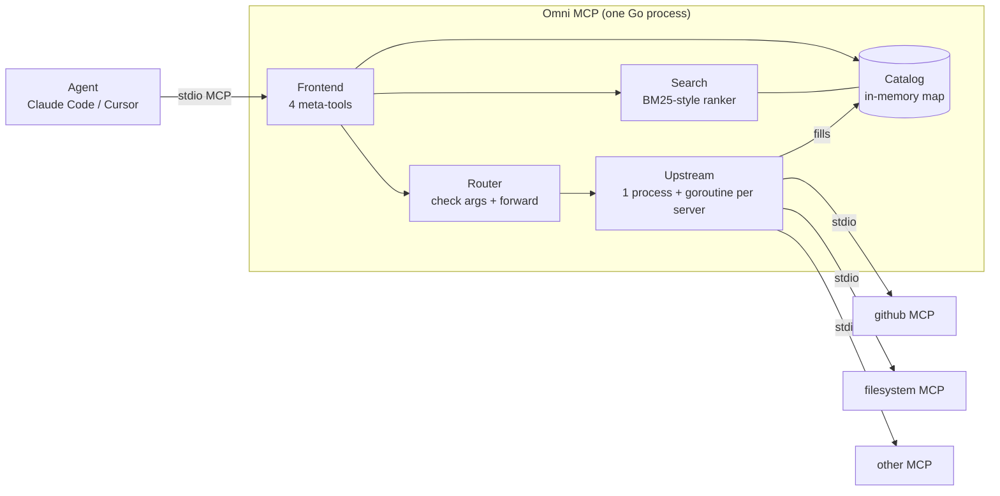
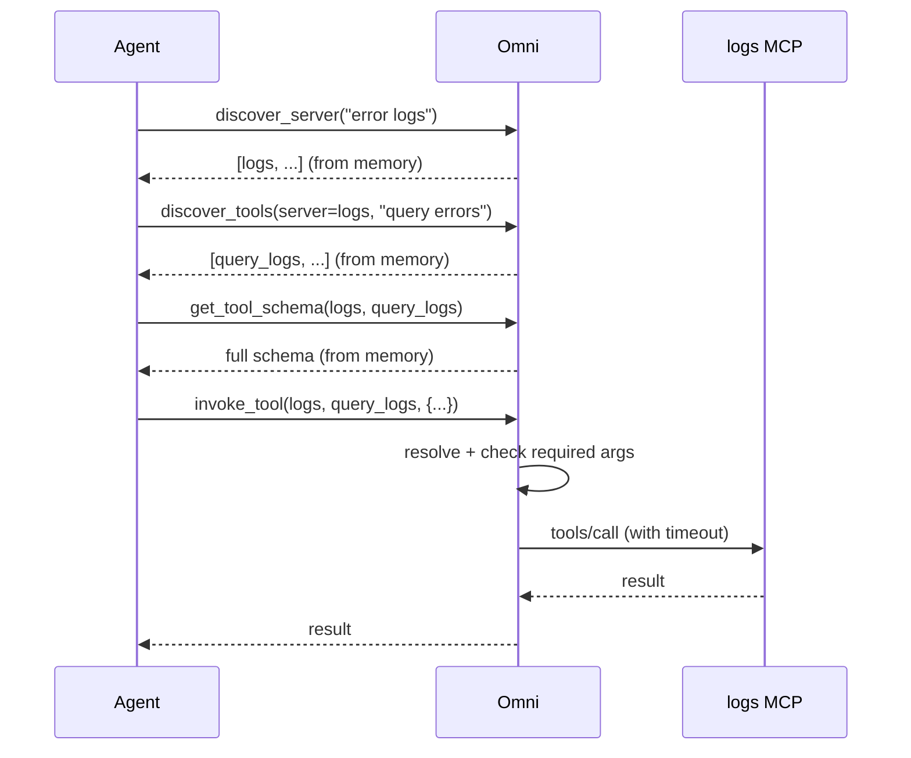

# Omni MCP — MVP Design (v0.1 "Does it work?")

Language: **Go** · Status: MVP implemented (see README code map) · Full design: [SYSTEM_DESIGN.md](SYSTEM_DESIGN.md)

## 1. Purpose of the MVP

The full design is large (8 components, many packages, 7 releases). Before building it, we
need to answer **one question** cheaply:

> If an agent sees only 4 meta-tools instead of every upstream tool, can it still find and
> call the right tool, and does it use far fewer tokens doing so?

The MVP exists to prove or disprove that. Everything that does not help answer it is cut.

### Success criteria (the "go / no-go" test)

| # | Criterion | Target |
|---|-----------|--------|
| 1 | Agent finishes real tasks through Omni against 2–3 real MCP servers | works end to end in Claude Code |
| 2 | Tool-definition tokens seen by the agent | < 2,000, constant as tools grow |
| 3 | Search Recall@5 on ~50 hand-labelled queries over ~200–500 tools | ≥ 85% |
| 4 | Token saving vs. loading all tools directly | ≥ 80% fewer tool-definition tokens |
| 5 | A crashing upstream does not break the agent or other upstreams | verified manually |

If 1–4 hold, the idea is viable → continue the full roadmap. If recall is poor, fix search
(embeddings, descriptions) *before* building anything else.

## 2. Scope

### In the MVP

- **Go**, single binary, **standard library only** (zero external dependencies).
- **stdio frontend** (works with Claude Code / Cursor), hand-written JSON-RPC 2.0.
- The **four meta-tools**: `discover_server`, `discover_tools`, `get_tool_schema`, `invoke_tool`.
- **Upstream manager**: connect to upstream MCP servers over **stdio** from `omni.json`;
  one child process + one reader goroutine per server (isolation); per-call timeout.
- **In-memory catalog**: on connect, `tools/list` (with pagination) → map keyed by `(server, tool)`.
- **Search**: simple BM25-style ranking written in ~100 lines of Go (word weights ×
  IDF), over tool name, description, server name/tags.
- **Minimal router**: resolve → check required arguments → forward with timeout → return result unchanged.
- Errors returned as `isError: true` tool results with a hint, never protocol errors.
- A server that fails to start is skipped; the rest keep working.

### Explicitly NOT in the MVP (deferred)

| Deferred | Back in |
|----------|---------|
| Embeddings, RRF fusion, re-ranker | v0.3 |
| SQLite persistence, schema versions, usage stats | v0.2 |
| Auto-restart of crashed upstreams, health checker, circuit breaker, hot reload | v0.4 |
| Full JSON-schema validation (MVP checks only `required`) | v0.2 |
| Policy / approvals / redaction / HTTP auth | v0.6 |
| Streamable HTTP transport, multi-session | v0.6 |
| Field projection, metrics, OpenTelemetry, Docker | v1.0 |

Rationale: none of these affect "can the agent find and call the right tool". They are
hardening, not validation.

## 3. Architecture (MVP)



Only the frontend is visible to the agent. Each upstream has its own child process and
goroutines, so a slow or dead server cannot block the others.

### Components → Go files

| Component | File | MVP responsibility |
|-----------|------|--------------------|
| Entry point | `cmd/omni/main.go` | Load config, build catalog, serve |
| Config | `internal/omni/config.go` | Parse `omni.json` |
| Upstream | `internal/omni/upstream.go` | Spawn process, `initialize`, `tools/list`, forward `tools/call` with timeout |
| Catalog | `internal/omni/catalog.go` | `map[server]*Upstream`, lookup by `(server, tool)` |
| Search | `internal/omni/search.go` | Tokenize, weight, rank |
| Frontend + router | `internal/omni/frontend.go` | The 4 meta-tools, arg check, error hints |
| Test helper | `cmd/fakeserver/main.go` | Fake upstream for local testing |

### Go concurrency model

- **Reader goroutine per upstream** reads replies and delivers them to waiting callers via
  a `map[id]chan` — requests and replies are matched by JSON-RPC id.
- **Goroutine per agent request** in the frontend, so one slow upstream call never blocks
  other requests.
- **Mutexes** guard only two things: writes to a child's stdin, and writes to our stdout.
- **`select` with `time.After`** implements the per-call deadline.

## 4. Meta-tool contract

| Tool | Input | Output |
|------|-------|--------|
| `discover_server` | `query`, `limit=5` | `[{server, description, tool_count, score}]` |
| `discover_tools` | `server?`, `query`, `limit=10` | `[{server, tool, description, score}]` |
| `get_tool_schema` | `server`, `tool` | full `inputSchema` + description + annotations |
| `invoke_tool` | `server`, `tool`, `arguments` | upstream `CallToolResult`, unchanged |

Rules:

- Tool identity is always the pair `(server, tool)` → no name clashes.
- Tool descriptions are short and teach the order: **discover → schema → invoke**.
- `discover_tools` without `server` searches across everything (shortcut for strong models).
- Errors carry a hint, e.g. `unknown tool "x" on server "github". Use discover_tools to search`.

## 5. Request flow

Example: *"find error logs for the payments service in the last hour"*



Three of four calls are answered from Omni's own memory in milliseconds; only `invoke_tool`
touches an upstream.

## 6. Config (MVP)

`omni.json`:

```json
{
  "servers": [
    {
      "name": "filesystem",
      "command": "npx",
      "args": ["-y", "@modelcontextprotocol/server-filesystem", "/tmp"],
      "description": "Read and write local files",
      "tags": ["files"],
      "timeout_ms": 15000
    },
    {
      "name": "github",
      "command": "npx",
      "args": ["-y", "@modelcontextprotocol/server-github"],
      "env": { "GITHUB_PERSONAL_ACCESS_TOKEN": "${GITHUB_TOKEN}" },
      "description": "Repos, issues, pull requests",
      "tags": ["code", "git"]
    }
  ]
}
```

JSON is used in the MVP so that the standard library suffices (`encoding/json`). The full
design moves to TOML. Tokens come from environment variables (`${VAR}` is expanded); never logged.

## 7. Code layout

```
omni-mcp/
├── go.mod
├── omni.json
├── cmd/
│   ├── omni/main.go          # entry point
│   └── fakeserver/main.go    # fake upstream for tests
├── internal/omni/
│   ├── config.go
│   ├── upstream.go
│   ├── catalog.go
│   ├── search.go
│   └── frontend.go
└── docs/
```

Split into the packages of the full design (`core`, `upstream`, `catalog`, `search`,
`router`, `server`, `bench`) only once the MVP passes. Splitting early is overhead.

## 8. Validation plan

1. **Smoke test** — connect Omni to 2 real servers (filesystem + one more); call each of the
   4 meta-tools from Claude Code.
2. **Search benchmark** — pool real tools (~50–100) plus synthetic duplicates to reach
   ~500; write ~50 labelled queries including near-duplicate traps; report Recall@1, @5, MRR.
3. **Token comparison** — count tokens of all tool definitions loaded directly vs. the 4
   meta-tool definitions.
4. **Failure test** — kill an upstream process mid-session: agent gets a clean `isError`
   result and other servers keep working.
5. **Task test** — give the agent 5–10 real tasks; record success, number of round trips,
   total tokens, versus connecting servers directly.

Already verified with the fake upstream: 4-tool listing, server and tool search, missing
argument error, successful call pass-through, and a broken server being skipped.

## 9. Risks the MVP is meant to expose

| Risk | How we'll see it | If it happens |
|------|------------------|---------------|
| Keyword search misses intent ("find logs" vs `query_events`) | Recall@5 < 85% | add embeddings (v0.3) early |
| Agents skip discovery or call in wrong order | task test failures | tune meta-tool descriptions |
| Extra round trips cost more than they save | task test: tokens + latency | add combined `search_and_schema` |
| Upstream descriptions too terse | low recall on specific tools | LLM description enrichment |
| Hand-written JSON-RPC misses a protocol detail | smoke test with real servers | switch to the official Go SDK |

## 10. Build order

1. ✅ Config + spawn a stdio upstream, `initialize` + `tools/list`.
2. ✅ Frontend with the 4 tools.
3. ✅ Catalog + `invoke_tool` forwarding.
4. ✅ Keyword search for `discover_server` / `discover_tools`.
5. ✅ Required-argument check and error hints.
6. ⏳ Run against real servers in Claude Code.
7. ⏳ Benchmark script (`bench/`), then decide: **go / no-go**.

## 11. Open questions

- Which 2–3 upstream servers for the demo? (suggest: filesystem, github, one more with many tools)
- Is the task test done manually or scripted?
- Adopt the official Go MCP SDK (`github.com/modelcontextprotocol/go-sdk`) after the MVP, or keep the hand-written protocol layer?
